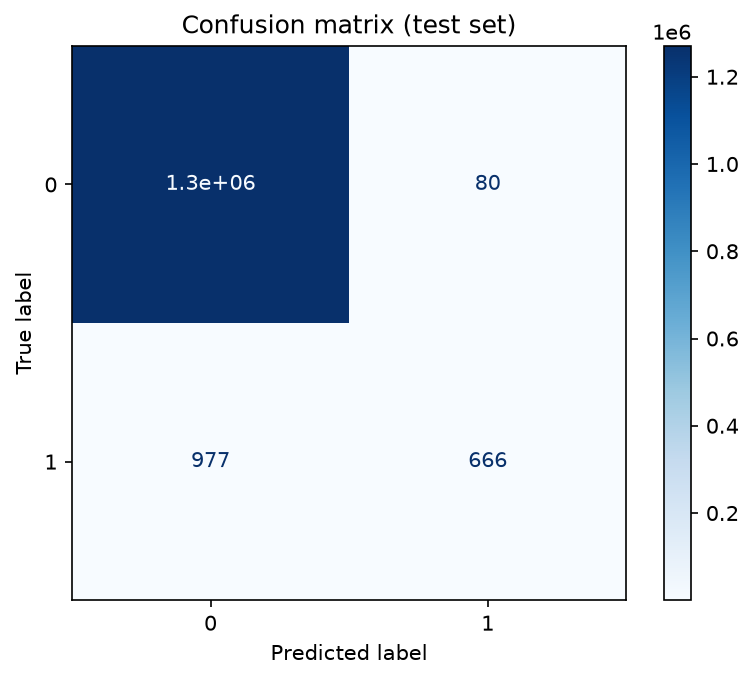
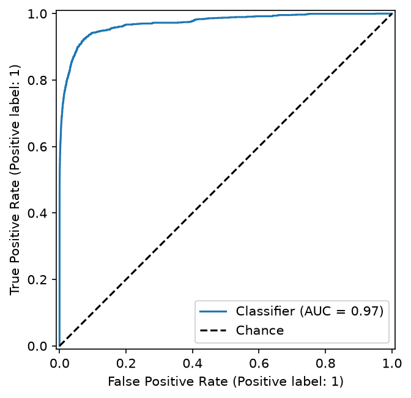

# fraudulent-payment-eda

Predicting whether a payment transaction is fraudulent or legitimate using logistic regression.

<a href="#" style="background-color: #000000; color: #0055aa; padding: 4px 12px; border-radius: 20px; text-decoration: none; font-size: 12px; font-weight: bold; margin-right: 5px;">AI101 Mini-Project</a>
<a href="#" style="background-color: #000000; color: #0055aa; padding: 4px 12px; border-radius: 20px; text-decoration: none; font-size: 12px; font-weight: bold; margin-right: 5px;">Team 17</a>
<a href="#" style="background-color: #000000; color: #0055aa; padding: 4px 12px; border-radius: 20px; text-decoration: none; font-size: 12px; font-weight: bold;">Python 3.12+</a>

***TEAM and their Roles***
| Member | Entry no. | Role | GitHub Handle |
| :--- | :--- | :--- | :--- |
| Dikshant Kansal | 2026EEB1345 | Documentation lead | dk-iitrpr |
| Anish Meena | 2026AIB1016 | Run and reproducibility lead | AnishMeena03 |
| Nikita Patel | 2026ESB1484 | PPT lead | 2026esb1484-cmd |
| Ayati Jain | 2026MCB1520 | Video lead | Ayati-itrpr |

*All four members contributed code (see the commits)*

# Problem Statement
Predicting whether a digital payment transaction is fraudulent or legitimate using transaction-related features.

# Problem Objectives
- Analyse the Online Payments Fraud Detection Dataset
- Investigate the common patterns in a fraudulent payment
- Build a model to detect whether the done payment is fraud or not

# Dataset
We used the "Online Payments Fraud Detection Dataset" dataset from Kaggle, made by Rupak Roy/ Bob.

Link: https://www.kaggle.com/datasets/pythonafroz/renewable-power-generation-and-weather-conditions

The file is in 5 splits in the data/ folder. Some basic facts about it:

6,362,620 rows and 11 columns
Readings were last updated was in 2021
No missing values and no duplicate rows

Columns :
| Column | What it represents |
|---|---|
| step | represents a unit of time where 1 step equals 1 hour |
| type | type of online transaction |
| amount | the amount of the transaction |
| nameOrig | customer starting the transaction |
| oldbalanceOrg | balance before the transaction |
| newbalanceOrg | balance after the transaction |
| nameDest | recipient of the transaction |
| oldbalanceDest | initial balance of recipient before the transaction |
| newbalanceDest | the new balance of recipient after the transaction |
| isFraud | fraud transaction |

## What we did

1. Looked at the data (size, column types, first few rows).
2. Cleaned it: checked for missing values and duplicates, and converted the Time column to a proper date-time format.
3. Explored it with summary statistics.
4. Calculated correlations between all the columns.
5. Choose which columns are needed
6. Trained a Logistic Regression model.
7. Wrote down what we found.

All of the results are in the folder `outputs/`.

# Project Structure

```text

fraudulent-payment-eda/
    ├── data/
    |     ├── dataset-part-001.csv
    |     ├── dataset-part-002.csv
    |     ├── dataset-part-003.csv
    |     ├── dataset-part-004.csv
    |     └── dataset-part-005.csv      # The original dataset contains 6362620 rows and 11 columns
    |
    ├── outputs/
    |
    ├── src/
    |     ├── config.py      # paths, constants, random seed
    │     ├── data.py        # load + split
    │     ├── model.py       # build_model()
    │     ├── evaluate.py    # metrics + plots
    │     └── main.py        # entry point: calls the above in order
    |
    ├── requirements.txt
    └── README.md

```

What each script does:

- `main.py` runs the other three scripts in order using Python's `subprocess` module. It also sets the main project folder as the working directory, so the code finds `data/.csv` and saves outputs in the right place no matter where you start it from.
- `data.py` combines all the datasets along featuring the needed columns and form a split_data function.
- `model.py` contains the logistic models function.
- `evaluate.py` generates the statistics and results and saves the graphs in `outputs/` for a dataset fed in the `main.py`.
- `config.py` retains the path of the output results in `.pngs` and `.json`


# Setup in detail

## Prerequisties
- Python 3.10+
- Pip installed

1. Clone the repository

```bash
git clone https://github.com/dk-iitrpr/fraudulent-payment-eda.gi
```

then

```bash
cd fraudulent-payment-eda
```

2. Create a virtual environment (optional, but it keeps the project libraries separate from the rest of your system)

```bash
python -m venv venv
source venv\bin\activate    #Windows: venv\Scripts\activate
```

3. Install the libraries

```bash
pip install -r requirements.txt
```

`requirements.txt` should contain:

```text
numpy
pandas
matplotlib
scikit-learn
```

4. Make sure all 5 `.csv` are inside the `data/` folder.

5. Run the project

```bash
python src/main.py
```

Use `python3` instead of `python` on Mac or Linux if needed. If everything works, the last line printed in the terminal is "All steps completed successfully!". After that you can open the `outputs/` folder to see the graphs and json file.

## Expected Output

After successfully executing the python files, the project produces:

- Confusion Matrix
- Metrics.json
- odds ratios.
- ROC curve.

### Model Evaluation Results

| Metric | Value |
|---|---:|
| accuracy | 0.9991693673360974 |
| precision | 0.8927613941018767 |
| recall | 0.40535605599513086 |
| f1 | 0.5575554625366262 |
| roc_auc | 0.971716274345499 |
| baseline_accuracy | 0.9987088652159016 |

### Output Screenshots

**Confusion Matrix**



**ROC curve**



## Project Links
- Presentation Slides (in `.pdf` form) : 
- Demonstration Video : 

# Ai-use discloser
Claude was used as a supporting tool during this project for understanding machine learning concepts and improving the code. The project implementation, model execution, result analysis, and final decisions were carried out and reviewed by the team.